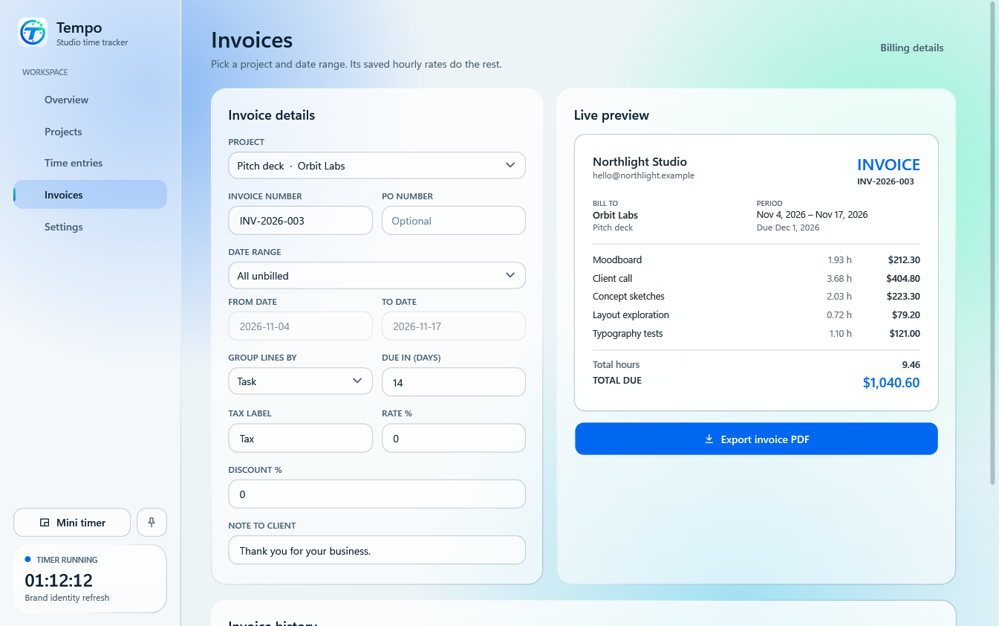

# Tempo

A free, open-source **studio time tracker for Windows 11**. Track hours per client project, then turn them into polished PDF invoices. Built with WPF and a glassmorphism UI (Mica backdrop, translucent cards, light and dark themes).


| | |
|---|---|
|  |  |
|  |  |

### Mini timer

Press **Ctrl+M** (or the *Mini timer* button) to shrink Tempo to a tiny 200 × 100 always-on-top timer: clock, start/pause/stop and a project picker. Picking another project saves the running session and starts the new one straight away, so switching is one click. The pin button keeps either window above everything else.

<p align="center">&nbsp;&nbsp;</p>

### Your language

English, Español, Français, Deutsch, Português (Brasil), Italiano, 日本語, 简体中文 and 한국어, switchable instantly in Settings (and picked automatically from Windows on first run). Invoices are issued in the language you chose.


### Invoice PDF

Invoices are written by Tempo's own PDF engine, with embedded fonts, so accents and non-Latin text come out right.

<p align="center"></p>

## Features

- **Timer** with pause/resume, a progress ring, a tray icon, and `Ctrl+Space` to start or pause from anywhere in the app.
- **Mini view**: a compact, optionally always-on-top timer (`Ctrl+M`) with one-click project switching. The full window can be pinned on top too.
- **9 languages**, switchable live, with localised dates and invoices.
- **Idle detection**: when you come back, choose to keep, remove, or remove-and-stop.
- **Projects** per person or brand, each with its own hourly rate (cents supported), colour, and client contact details. Archive to hide a project, or delete it (with its entries) after a clear confirmation.
- **Time entries**: add, edit and delete by hand (billed entries too), filter and search, export to CSV (spreadsheet-formula safe, includes time zone and UTC offset).
- **Invoices**: live preview, PDF export, tax and discount, PO number, due date, 14 currencies, logo, payment instructions, optional time rounding (6/15/30 min), history with Paid / Overdue / Void, and permanent delete. Entries are marked as billed, so nothing is invoiced twice.
- **Time zones**: everything is stored in UTC and shown in the zone you choose; invoices record the zone they were issued in.
- **Safe data**: atomic saves with a `.bak` copy, automatic recovery from a damaged file, backup/restore from Settings. Tempo never deletes old entries.
- **Glass UI**: Windows 11 Mica or Acrylic backdrop (solid fallback on older Windows), light/dark/system theme.

## Install

Download `Tempo.exe` from [Releases](../../releases) and run it. It needs the free [.NET 8 Desktop Runtime](https://dotnet.microsoft.com/download/dotnet/8.0). The exe is unsigned, so Windows SmartScreen may show a warning the first time.

## Build from source

```bash
dotnet build
dotnet run
```

Single-file release build:

```bash
dotnet publish -c Release -r win-x64 --self-contained false -p:PublishSingleFile=true -o publish
```

Pushing a tag such as `v2.4.0` makes GitHub Actions build the exe and attach it to a release (see `.github/workflows/build.yml`).

## Your data

Stored locally in `%LOCALAPPDATA%\TempoStudio\tempo-data.json`. Nothing is sent anywhere; Tempo makes no network requests.

## Developer options

These only work when the `TEMPO_DATA_DIR` environment variable points at a scratch folder, so they can never touch real data:

```powershell
$env:TEMPO_DATA_DIR = "$env:TEMP\tempo-demo"
.\Tempo.exe --demo                                   # fictional sample data
.\Tempo.exe --demo --shot out --theme Dark --lang de   # render each page (and the mini view) to PNG
.\Tempo.exe --demo --lang ja                           # start in another language
.\Tempo.exe --demo --sample-pdf out.pdf             # write a realistic sample invoice PDF and exit
.\Tempo.exe --demo --selftest-pdf out.pdf           # stress-test PDF (30 lines, accents, CJK) and exit
```

## Credits

Tempo has **no third-party dependencies**. The glass UI, the data layer and the invoice PDF writer (`Pdf.cs`, with embedded font subsetting) are all written in-house on top of .NET and WPF. Tempo is MIT licensed (see `LICENSE`).
