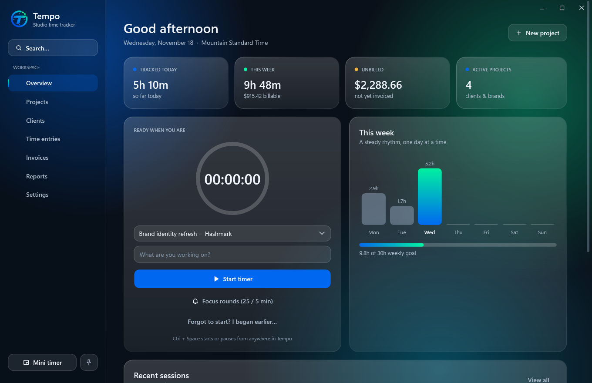
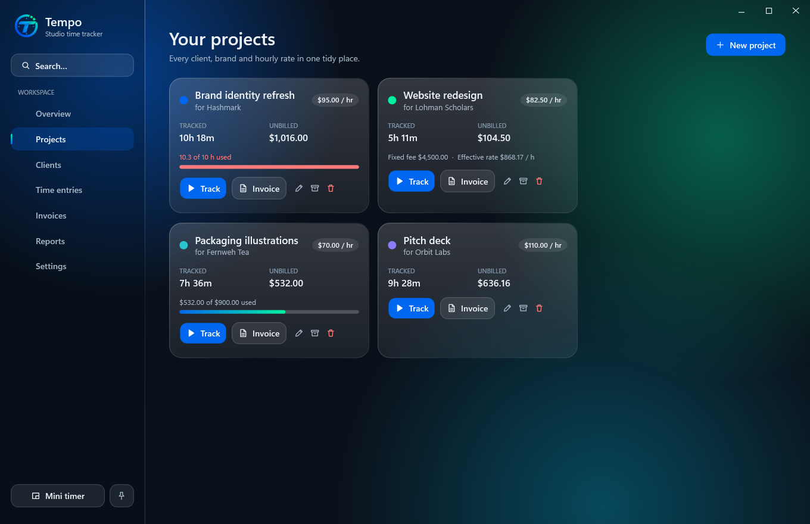
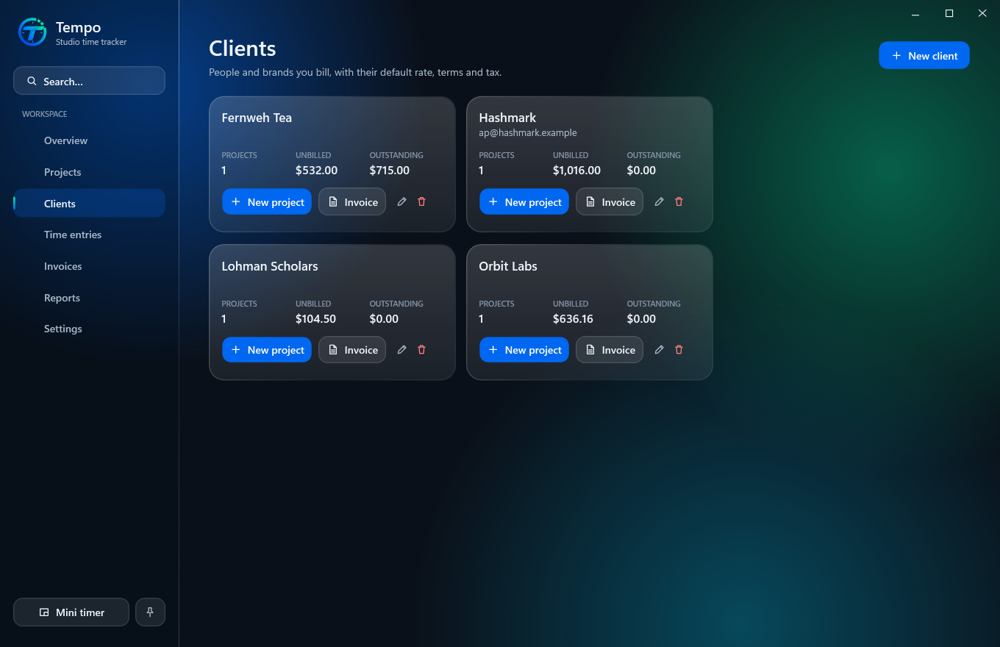
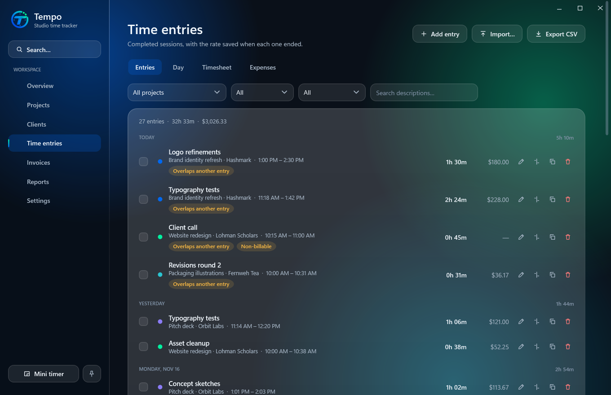
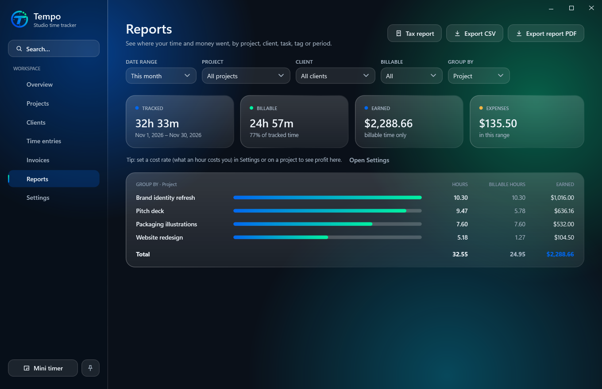
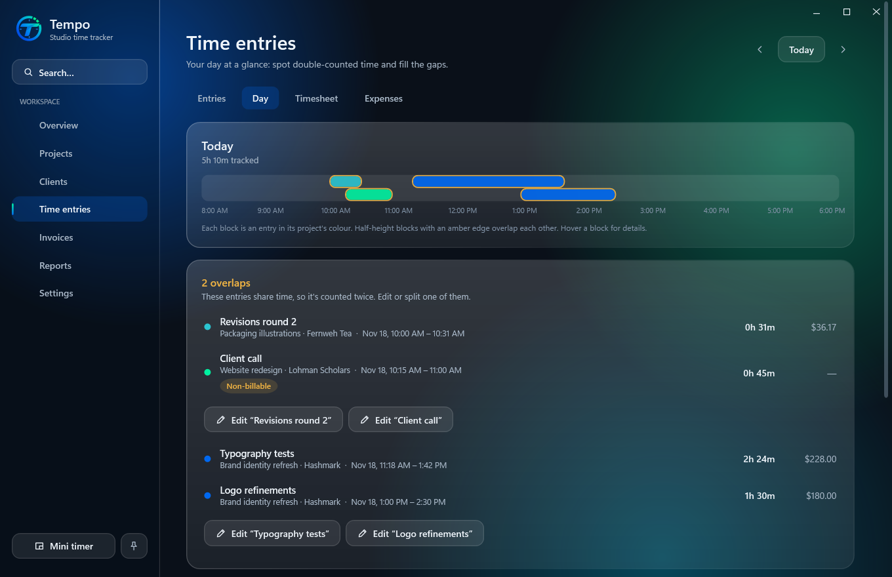
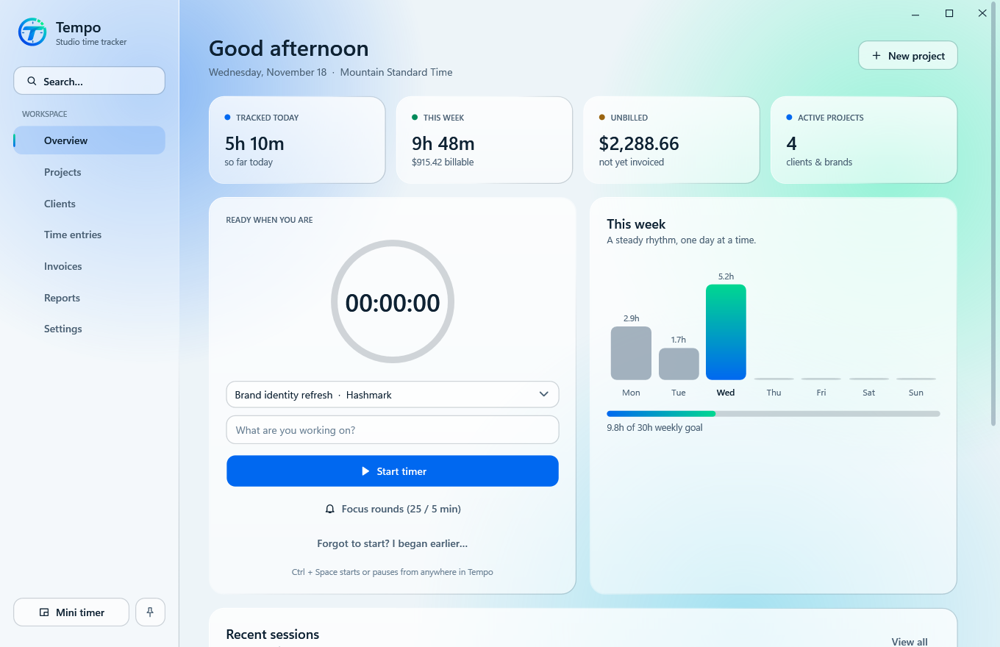
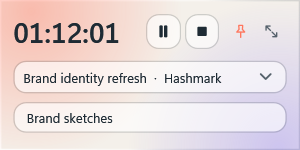
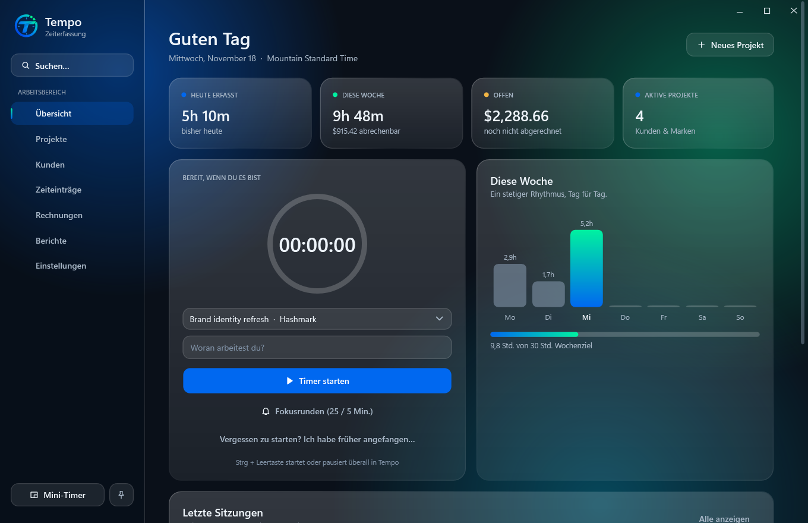

# Tempo

A free, open-source **time tracker and invoicing app for Windows 11**. Track hours per client and project, keep an eye on budgets, then turn your time into polished PDF invoices and quotes. Built with WPF and a glassmorphism UI (Mica backdrop, translucent cards, light and dark themes).



| | |
|---|---|
|  |  |
|  |  |
|  |  |
|  |  |
|  |  |

### Mini timer

Press **Ctrl+M** (or the *Mini timer* button) to shrink Tempo to a tiny 200 × 100 always-on-top timer: clock, start/pause/stop and a project picker. Picking another project saves the running session and starts the new one straight away. The pin button keeps either window above everything else.

<p align="center">&nbsp;&nbsp;</p>

### Your language

English, Español, Français, Deutsch, Português (Brasil), Italiano, 日本語, 简体中文 and 한국어. You can switch instantly in Settings, and on first run Tempo picks your Windows language. Invoices are issued in the language you chose.



### Invoice PDF

Invoices are written by Tempo's own PDF engine, with embedded fonts, so accents and non-Latin text come out right. Each invoice can carry a pay-now link and a QR code. There are three templates (Classic, Minimal, Bold), and an optional timesheet page can be attached.

<p align="center"></p>

## Features

**Tracking**
- **Timer** with pause/resume, a progress ring and a tray icon. There's also a **"forgot to start? I began 20 minutes ago"** option.
- **Global shortcut** (default `Ctrl+Alt+Space`) to start or pause from any app. Inside Tempo, `Ctrl+Space` does the same.
- **Reminders**: a nudge when you're at the computer but not tracking, and an end-of-day warning if a timer is still running.
- **Idle detection**: when you come back, choose to keep the time, remove it, or remove it and stop.
- **Start with Windows**: Tempo can open quietly in the tray when you sign in.
- **Mini view** (`Ctrl+M`) and **command palette** (`Ctrl+K`): jump anywhere, switch the timer, or create things from the keyboard.
- **Focus rounds** (Pomodoro): 25 minutes on, 5 off, or your own lengths, with a nudge at each switch. Set a **daily goal** as well as a weekly one.
- **Day timeline**: see your day as blocks, spot **overlapping entries** (time counted twice) and fill **untracked gaps** in one click.
- **Activity suggestions** (opt-in, off by default): Tempo notes which app is in front every 30 seconds and suggests entries for time you forgot to track. Nothing leaves your PC, notes are deleted after 14 days, and window titles are optional.
- **Live calendars**: subscribe to the secret iCal address of your Google, Outlook or iCloud calendar, and your meetings appear on the Day tab, ready to become entries.

**Entries**
- Add, edit, **split**, **merge** and **duplicate** entries. Tick several entries to **bulk-edit** them (project, billable, tags) or delete them.
- **Billable / non-billable** flag and **tags** on every entry.
- **Weekly timesheet grid**: type hours straight into a project × day table.
- **Import** meetings from calendar files (`.ics` from Outlook, Google or Apple Calendar; repeating events included), or move your history over from **Toggl, Harvest or Clockify** CSV exports. Re-importing the same file never creates duplicates.
- **Undo** for deletes, plus a *Recently deleted* list in Settings.

**Clients, projects and money**
- **Clients** as real records (contact details, tax ID, default rate, currency, payment terms). Each **project** has its own hourly rate.
- **Budgets**: hours, amount, fixed fee or monthly retainer, with alerts at 80% and 100%.
- **Expenses** with receipt files, billable onto invoices.
- **Reports**: filter by date, client, project or tag. Group by any of them (or by team member), then export to CSV or PDF.
- **Profit**: set what an hour costs you (globally or per project) and reports show cost, profit and margin. Non-billable expenses count as costs.
- **Several currencies**: clients can be billed in their own currency, and an exchange-rate table converts everything into yours for reports.

**Invoicing**
- Live preview and PDF export, with tax, discounts, PO number, due date, 14 currencies, your logo and payment instructions.
- **Quotes** that turn into invoices in one click, and **recurring invoices** for retainers and repeat work.
- **Partial payments**, **late fees**, and a **pay-now link with a QR code**.
- History shows Paid, Partial, Overdue and Void at a glance. Entries are marked as billed, so nothing is invoiced twice.
- **Taxes**: a second tax line (for example GST + PST), **EU reverse charge** with the required wording and the customer's VAT ID, and a **tax report** per tax and currency, exportable to CSV.
- **Email from Tempo**: opens a ready-to-send email in your mail app with the PDF attached, in the invoice's language. You always press Send yourself. Overdue invoices get a **payment reminder** button.

**Sync and teams (no server, no account)**
- Pick a folder you already sync (OneDrive, Dropbox, Google Drive, a network share). Each PC or teammate writes its own file there every 2 minutes and reads the others'.
- The newest edit wins, and deletions travel. Anything removed by sync lands in *Recently deleted*, and a large batch of deletions from another device waits for you to confirm it.
- Each entry carries the name of whoever tracked it, and reports can group by member.

**Safe data**
- **Time zones**: everything is stored in UTC and shown in the zone you choose.
- **Atomic saves** with a `.bak` copy, and recovery from a damaged file.
- **Automatic daily backups** to any folder you choose, such as OneDrive or Dropbox.
- **Accessibility**: works with screen readers (toasts are announced), shows visible keyboard focus everywhere, and respects high-contrast, "transparency effects off" and "animation effects off".

## Install

Download **`Tempo-Setup-x.y.z.exe`** (installer: per-user, no admin rights) or the portable **`Tempo.exe`** from [Releases](../../releases). Tempo needs the free [.NET 8 Desktop Runtime](https://dotnet.microsoft.com/download/dotnet/8.0); the installer tells you if it's missing. Release builds are only code-signed when a certificate is configured, so Windows SmartScreen may show a warning the first time.

**Updates:**
- With *Check GitHub for new versions* on, Tempo tells you when a release is out.
- In the installed version, **Install update** downloads the installer and checks it against the release's SHA-256 checksum. If your copy of Tempo is signed, it also checks that the update is signed by the same certificate. Then it runs the installer.
- The portable exe just opens the release page.

**winget:** manifests are in `packaging/winget/` (validated with `winget validate`).

**Something wrong?** Use *Settings → About → Report a problem*. It opens a pre-filled GitHub issue with the error log. Your user folder, user name, PC name and sync folder are hidden, and nothing is posted until you submit it.

## Build and test from source

```powershell
dotnet build
dotnet run
powershell -File scripts/test.ps1          # build + self-test suite (SelfTest.cs) + UI test (every page and tab in all 9 languages)
powershell -File scripts/test.ps1 -Full    # + Release build with warnings as errors + single-file publish
```

Pushing a tag such as `v2.6.0` makes GitHub Actions do the following:
- run the tests
- build the exe and the Inno Setup installer
- sign both, if the `SIGNING_CERT_BASE64` and `SIGNING_CERT_PASSWORD` secrets are set
- attach them to a release with SHA-256 checksums

See `.github/workflows/build.yml`.

## Your data and privacy

Your data is stored locally in `%LOCALAPPDATA%\TempoStudio\tempo-data.json`. Tempo makes **no network requests** unless you turn one of these on:
- **Update check:** asks GitHub for the latest version number.
- **Calendar subscriptions:** reads the calendars you add, every 30 minutes.
- **Installing an update:** only when you click Install.

Activity tracking and sync never use the internet. Sync only reads and writes files in the folder you choose.

## Developer options

These options only work when the `TEMPO_DATA_DIR` environment variable points at a scratch folder, so they can never touch real data:

```powershell
$env:TEMPO_DATA_DIR = "$env:TEMP\tempo-demo"
.\Tempo.exe --demo                                     # fictional sample data
.\Tempo.exe --demo --shot out --theme Dark --lang de   # render each page, tab, dialog and the mini view to PNG
.\Tempo.exe --demo --sample-pdf out.pdf --template Bold  # write a realistic sample invoice PDF and exit
.\Tempo.exe --selftest out.txt                         # run the self-test suite and write PASS/FAIL lines
.\Tempo.exe --demo --uitest out.txt                    # drive every page, tab and dialog in every language
```

This repo also includes a Claude Code setup: `CLAUDE.md`, `.claude/agents` and `.claude/commands`. That setup enforces strict test-first development with a hook that runs the suite after every edit.

## Credits

Tempo has **no third-party dependencies**. The glass UI, the data layer, the invoice PDF writer (`Pdf.cs`, with embedded font subsetting) and the QR encoder (`Qr.cs`) are all written in-house on top of .NET and WPF. Tempo is MIT licensed (see `LICENSE`).
