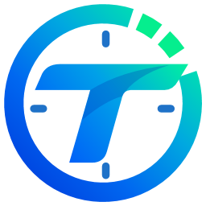
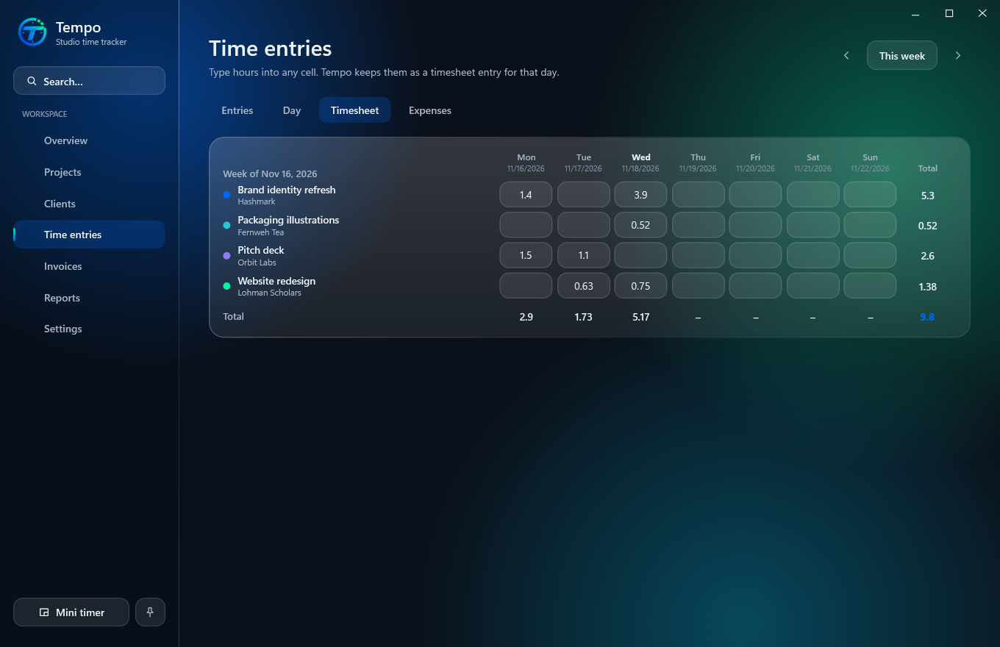
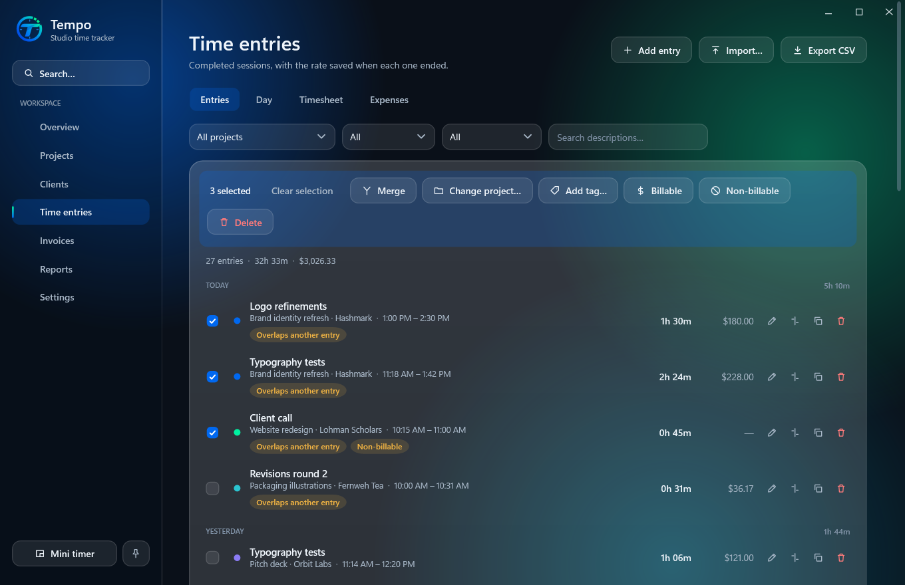
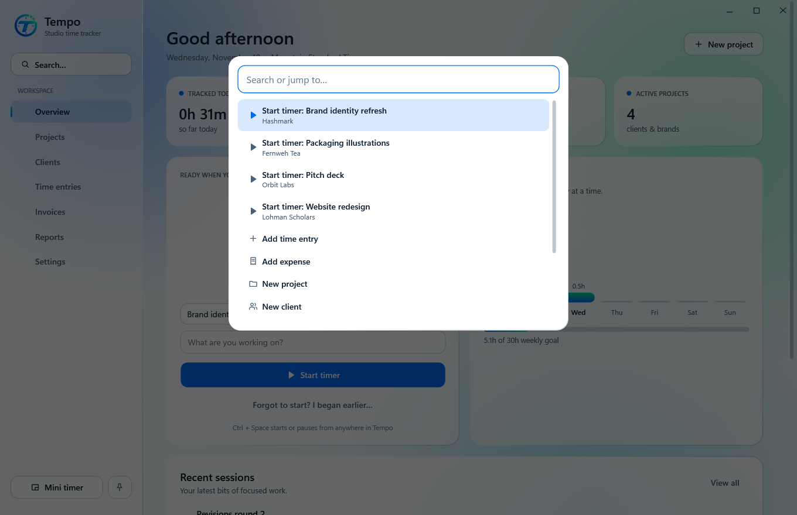
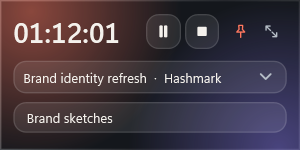
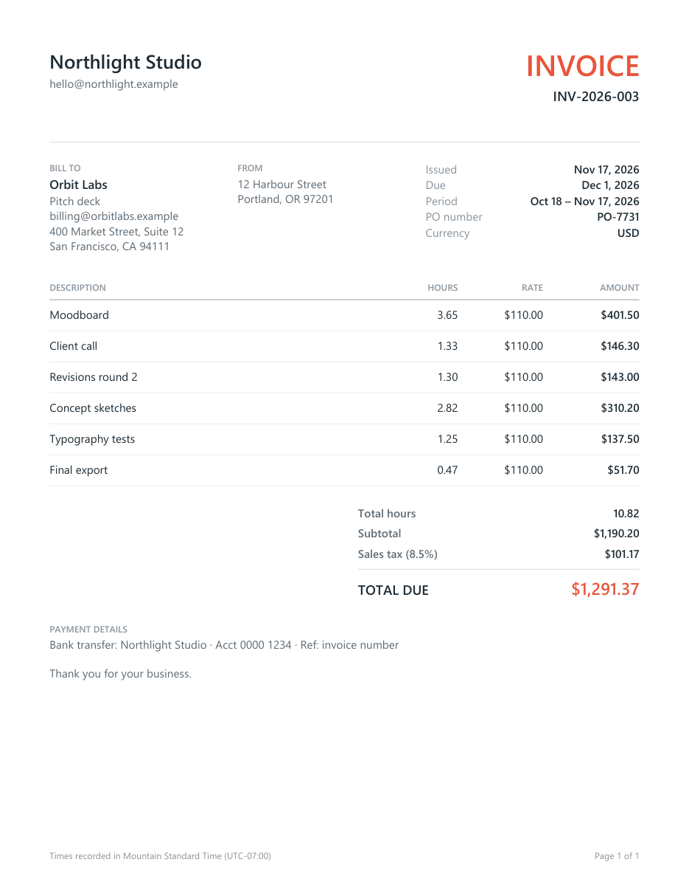

<p align="center">
  
</p>

<h1 align="center">Tempo</h1>

<p align="center">
  A free, open-source time tracker and invoicing app for Windows.<br>
  Track hours per client and project, watch your budgets, then turn your time into polished PDF invoices and quotes.<br>
  <strong>No account. No server. No telemetry. MIT licensed.</strong>
</p>

<p align="center">
  <a href="LICENSE"></a>
  
  <a href="../../releases/latest"></a>
  
</p>

<p align="center">
  <a href="#features">Features</a> ·
  <a href="#screenshots">Screenshots</a> ·
  <a href="#install">Install</a> ·
  <a href="#integrations-bring-your-own-key">Integrations</a> ·
  <a href="#privacy">Privacy</a> ·
  <a href="#build-from-source">Build from source</a>
</p>


> **Status: 2.9.0, stable.** Download the installer or portable exe from [Releases](../../releases/latest).
> Every build runs hundreds of logic and UI checks in all 9 languages before it ships.

## Features

### Track your time
- **Timer** with pause/resume, a progress ring and a tray icon. Forgot to start? Tell Tempo *"I began 20 minutes ago"*.
- **Global shortcut** (default `Ctrl+Alt+Space`) starts or pauses from any app. Inside Tempo, `Ctrl+Space` does the same.
- **Mini timer** (`Ctrl+M`): a tiny always-on-top window with the clock, start/pause/stop and a project picker.
- **Command palette** (`Ctrl+K`): jump anywhere, switch the timer or create things from the keyboard.
- **Focus rounds** (Pomodoro): 25 minutes on, 5 off, or your own lengths. Set a **daily goal** as well as a weekly one.
- **Reminders** when you're at the computer but not tracking, and an end-of-day warning if a timer is still running.
- **Idle detection**: when you come back, keep the time, remove it, or remove it and stop.
- **Day timeline**: see your day as blocks, spot **overlapping entries** and fill **untracked gaps** in one click.
- **Activity suggestions** (opt-in, off by default): Tempo notes which app is in front every 30 seconds and suggests entries for time you forgot. Nothing leaves your PC, and notes are deleted after 14 days.
- **Live calendars**: subscribe to the secret iCal address of your Google, Outlook or iCloud calendar, and meetings appear on the Day tab, ready to become entries.
- **Start with Windows**: Tempo can open quietly in the tray when you sign in.

### Manage entries
- Add, edit, **split**, **merge** and **duplicate** entries. Tick several to **bulk-edit** (project, billable, tags) or delete them.
- **Billable / non-billable** flag and **tags** on every entry.
- **Weekly timesheet**: type hours straight into a project × day grid.
- **Import** calendar files (`.ics` from Outlook, Google or Apple, repeating events included) or your history from **Toggl, Harvest or Clockify** CSV exports. Re-importing never creates duplicates.
- **Undo** for every delete, plus a *Recently deleted* list in Settings.

### Clients, projects and money
- **Clients** as real records: contact details, tax ID, default rate, currency and payment terms. Each **project** has its own hourly rate.
- **Budgets**: hours, amount, fixed fee or monthly retainer, with alerts at 80% and 100%.
- **Expenses** with receipt files, billable onto invoices.
- **Reports**: filter by date, client, project or tag, group by any of them (or by team member), and export to CSV or PDF.
- **Profit**: set what an hour costs you and reports show cost, profit and margin.
- **Several currencies**: bill clients in their own currency; an exchange-rate table converts everything into yours for reports.

### Invoices and quotes
- Live preview and PDF export with tax, discounts, PO number, due date, 14 currencies, your logo and payment instructions.
- **Three templates** (Classic, Minimal, Bold) and an optional **timesheet page**.
- **Quotes** that turn into invoices in one click, and **recurring invoices** for retainers.
- **Partial payments**, **late fees**, and a **pay-now link with a QR code**.
- Paid, Partial, Overdue and Void at a glance. Billed entries are marked, so nothing is invoiced twice.
- **Taxes**: a second tax line (for example GST + PST), **EU reverse charge** with the required wording, and a **tax report** per tax and currency.
- **Email from Tempo**: opens a ready-to-send email in your mail app with the PDF attached, in the invoice's language. You always press Send yourself. Overdue invoices get a **payment reminder** button.

### Integrations (bring your own key)
Connect your own accounts in *Settings → Integrations*. Keys are encrypted with Windows' per-user protection (DPAPI) and kept in their own file, so they never appear in backups, sync files or problem reports.

| Service | What it does | Key you need |
|---|---|---|
| **Square** | *Send with Square* creates the invoice in your Square account (customer, lines, discount, taxes, due date). Tempo shows the recipient and exact amount; Square emails it only after you confirm. Payments sync back every 15 minutes and mark the invoice *Paid*. A *Sandbox* switch lets you test first. | Access token from your free app in the Square Developer Console |
| **Stripe** | Use a Stripe payment link as the invoice's pay link. Tempo adds the invoice number, checks completed payments every 15 minutes and records them. | Restricted key with *Checkout Sessions: Read* |
| **GitHub** | *Pick a task* fills the description with an issue assigned to you. | Read-only personal access token |
| **Jira** | Same, with your Jira issues. | API token |
| **Asana** | Same, with your Asana tasks. | Personal access token |

### Sync and teams (no server, no account)
- Pick a folder you already sync (OneDrive, Dropbox, Google Drive, a network share). Each PC or teammate writes its own file there every 2 minutes and reads the others'.
- The newest edit wins and deletions travel. Anything removed by sync lands in *Recently deleted*, and a large batch of deletions waits for you to confirm.
- Each entry carries the name of whoever tracked it, and reports can group by member.

### Safe data
- **Time zones**: everything is stored in UTC and shown in the zone you choose.
- **Atomic saves** with a `.bak` copy, and recovery from a damaged file.
- **Automatic daily backups** to any folder you choose.

### Built for everyone
- **9 languages**: English, Español, Français, Deutsch, Português (Brasil), Italiano, 日本語, 简体中文 and 한국어. Tempo picks your Windows language on first run, and invoices are issued in the language you choose.
- **Accessibility**: works with screen readers, visible keyboard focus everywhere, and respects high contrast, "transparency effects off" and "animation effects off".
- **Glass interface**: Mica backdrop, translucent cards, light and dark themes.

## Screenshots

**Projects and clients:** rates, budgets and contact details at a glance.

| | |
|---|---|
|  |  |

**Time entries and the weekly timesheet:** edit one entry or type a whole week.

| | |
|---|---|
|  |  |

**Bulk edit and the day timeline:** fix many entries at once, spot overlaps and fill gaps.

| | |
|---|---|
|  |  |

**Reports and invoices:** filter, group, export, and bill.

| | |
|---|---|
|  |  |

**Light theme and the command palette** (`Ctrl+K`).

| | |
|---|---|
|  |  |

**Mini timer** (`Ctrl+M`): a 200 × 100 always-on-top timer. Picking another project saves the running session and starts the new one.

<p align="center">
  &nbsp;&nbsp;
  
</p>

**Your language:** the whole app, here in German.


**Invoice PDF:** written by Tempo's own PDF engine with embedded fonts, so accents and non-Latin text come out right. Each invoice can carry a pay-now link and QR code.

<p align="center"></p>

<sub>Screenshots use Tempo's built-in demo data (fictional clients and projects).</sub>

## Install

Download from the [latest release](../../releases/latest):

- `Tempo-Setup-<version>.exe`: installer (per-user, no admin rights needed)
- `Tempo.exe`: portable, single file, no installation
- `SHA256SUMS.txt`: checksums for both

**Requirements**

- Windows 11. The Mica and Acrylic backdrops need version 22H2 or newer; older versions use the solid style.
- The free [.NET 8 Desktop Runtime](https://dotnet.microsoft.com/download/dotnet/8.0). The installer tells you if it's missing.

Release builds are only code-signed when a certificate is configured, so Windows SmartScreen may show "Windows protected your PC". Check the download against `SHA256SUMS.txt`, then choose **More info → Run anyway** if you trust it.

Installing over an older version keeps your data.

### Updates

- With *Check GitHub for new versions* on, Tempo tells you when a release is out.
- In the installed version, **Install update** downloads the installer and checks it against the release's SHA-256 checksum. If your copy is signed, it also checks the update is signed by the same certificate.
- The portable exe opens the release page instead.

**winget:** manifests are in [`packaging/winget/`](packaging/winget/) (validated with `winget validate`).

### Something wrong?

Use *Settings → About → Report a problem*. It opens a pre-filled GitHub issue with the error log. Your user folder, user name, PC name and sync folder are hidden, and nothing is posted until you submit it.

## Privacy

Tempo works entirely on your computer. Your data lives in `%LOCALAPPDATA%\TempoStudio\tempo-data.json`.

It makes **no network requests** unless you turn one of these on:

| Feature | What it contacts | When |
|---|---|---|
| Update check | GitHub, for the latest version number | When enabled |
| Calendar subscriptions | The calendars you add | Every 30 minutes |
| Install update | GitHub, to download the installer | Only when you click Install |
| Integrations | Square, Stripe, GitHub, Jira or Asana, with your own key | Only the ones you connect |

- **Activity suggestions** and **sync** never use the internet. Sync only reads and writes files in the folder you choose.
- No analytics, no crash reporting, no accounts.

## Build from source

Prerequisites (both free):

- Windows 10/11 x64
- [.NET 8 SDK](https://dotnet.microsoft.com/download/dotnet/8.0)

```powershell
git clone https://github.com/ColeDonMedia/tempo-time-tracker.git
cd tempo-time-tracker
dotnet run
```

**Checks** (the same ones CI runs):

```powershell
powershell -File scripts/test.ps1          # build + self-test (SelfTest.cs) + UI test (every page and tab in all 9 languages)
powershell -File scripts/test.ps1 -Full    # + Release build with warnings as errors + single-file publish
```

**Releases:** pushing a tag such as `v2.9.0` makes GitHub Actions run the tests, build the exe and the Inno Setup installer, sign both (when the `SIGNING_CERT_BASE64` and `SIGNING_CERT_PASSWORD` secrets are set) and attach them to a release with SHA-256 checksums. See [`.github/workflows/build.yml`](.github/workflows/build.yml).

### Developer options

These only work when the `TEMPO_DATA_DIR` environment variable points at a scratch folder, so they can never touch real data:

```powershell
$env:TEMPO_DATA_DIR = "$env:TEMP\tempo-demo"
.\Tempo.exe --demo                                       # fictional sample data
.\Tempo.exe --demo --shot out --theme Dark --lang de     # render each page, tab, dialog and the mini view to PNG
.\Tempo.exe --demo --sample-pdf out.pdf --template Bold  # write a sample invoice PDF and exit
.\Tempo.exe --selftest out.txt                           # run the self-test suite (PASS/FAIL lines)
.\Tempo.exe --demo --uitest out.txt                      # drive every page, tab and dialog in every language
```

## Project layout

```
Assets/                  app icon (tempo.ico) and brand/logo.png
Pages/                   one file per page (Overview, Entries, Invoices, Settings...)
Themes/                  dark and light colour dictionaries, shared styles
Strings.*.cs             translation tables (9 languages per row)
Pdf.cs, Qr.cs            in-house PDF writer (with font subsetting) and QR encoder
Square.cs, Integrations.cs, IntegrationClient.cs   bring-your-own-key integrations
Sync.cs                  folder sync between PCs and teammates
SelfTest.cs, UiTest.cs   the test suites
docs/screenshots/        README screenshots (demo data)
installer/               Inno Setup script
packaging/winget/        winget manifests
scripts/                 test and signing scripts
.github/workflows/       CI and release build
.claude/, CLAUDE.md      Claude Code setup (test-first workflow, review agents)
```

## Credits and license

Tempo has **no third-party dependencies**. The glass UI, the data layer, the PDF writer and the QR encoder are all written in-house on top of .NET and WPF.

Tempo is released under the [MIT License](LICENSE).
